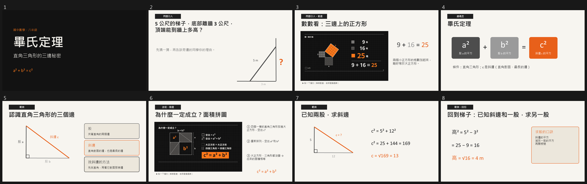
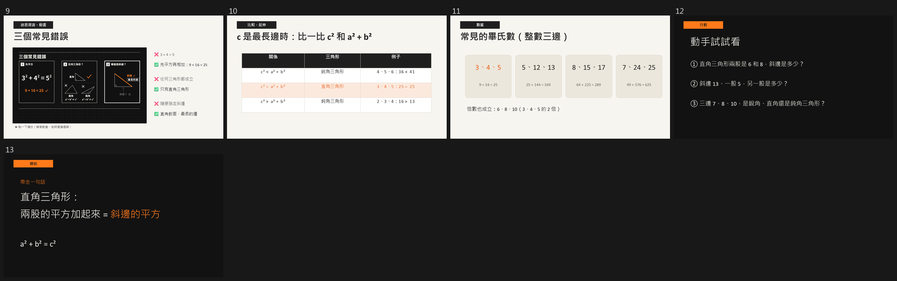
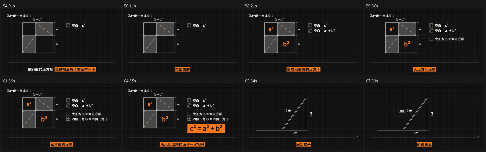

# soil-motion-deck

**一次製作，兩份成品：有動畫的教學簡報（.pptx），加上同內容的解說影片（MP4）。**

這是一個給 Claude Code（以及 Codex 等讀得懂 `SKILL.md` 的 agent）用的 skill，把兩個技能接在一起：

- [SOIL Teaching Deck](https://github.com/mathruffian-dot/soil-teaching-deck)：依李俊儀教授的 SOIL 六引擎，把教材做成有教學力的簡報。
- [claude-motion-explainer](https://github.com/mathruffian-dot/claude-motion-explainer)：用 HyperFrames 做配音、字幕、三色主題的原理解說動畫。

| 成品 | 內容 |
|---|---|
| **A 簡報** | SOIL 簡報，2–4 個 ★ 關鍵頁嵌入動畫片段。片段靜音、沒有字幕，老師邊播邊講；沒播放時，畫面停在動畫的結論 |
| **B 影片** | 同一份內容的完整解說片（配音 + 字幕），給學生預習、補課 |

動畫只做一次：先做 B，再從 B 的「靜音孿生版」剪出 ★ 頁那幾格，嵌進簡報。兩邊的秒數、用語、顏色完全一致。

## 範例：〈畢氏定理〉（國中八年級）

簡報 13 頁。第 3 頁是 3-4-5 方格，第 6 頁是拼圖證明，第 9 頁是三個常見錯誤，這三頁是動畫：




影片 110 秒、7 格。下圖是拼圖證明那一段，每個旁白子句截一格：



## 安裝

先裝好兩個上游技能（各自的 README 有說明），再裝這個：

```bash
git clone https://github.com/mathruffian-dot/soil-motion-deck.git
cp -r soil-motion-deck/skills/* ~/.claude/skills/        # Claude Code
# Codex / 其他 agent：複製到 ~/.agents/skills/
```

需要：Node.js 22+、ffmpeg、Python 3、HyperFrames，`pptxgenjs@3.12.0`，以及源石黑體（SOIL 技能會自動安裝）。檢查投影片版面時，Windows 用 PowerPoint 本身輸出縮圖；其他系統用 LibreOffice + poppler。

## 怎麼用

在 Claude Code 裡直接說：

```text
用 SOIL 幫我做「光合作用」的教學簡報，國中七年級、一節課。關鍵頁做成動畫，另外也要一支解說影片。
```

Agent 會先問科目、對象、時間、要哪幾份成品和配色，接著照 SOIL 的引擎一～三排好頁面，標出哪幾頁做動畫，給你確認後才開始做。

## 裡面有什麼

| 檔案 | 用途 |
|---|---|
| [`SKILL.md`](skills/soil-motion-deck/SKILL.md) | 完整流程：訪談 → SOIL 引擎一～三（標出 ★ 頁）→ 影片 → 剪片段 → SOIL 引擎四～六 → 審查 → 交付 |
| `scripts/make_silent.py` | 複製影片專案，拿掉旁白和字幕，做成「靜音孿生版」 |
| `scripts/cut_clips.py` | 讀轉場時間，自動剪出每個 ★ 頁的片段，避開交叉淡入淡出，另外輸出封面 PNG |
| `scripts/thumbs.py` | 把每頁投影片輸出成 PNG，再拼成總覽圖 |
| `templates/deck_helpers.js` | PptxGenJS 的共用元件：深色／淺色頁、角色徽章、標題、卡片、動畫播放視窗 |
| `templates/example_pythagoras.js` | 〈畢氏定理〉13 頁的完整範例 |
| `references/lessons.md` | 第一次實作踩過的坑 |

## English

An agent skill that joins the [SOIL Teaching Deck](https://github.com/mathruffian-dot/soil-teaching-deck) workflow with [claude-motion-explainer](https://github.com/mathruffian-dot/claude-motion-explainer): one production yields (A) a teaching .pptx whose key slides embed silent, caption-free animation clips with poster frames, and (B) a narrated, captioned explainer MP4 of the same content. The clips are cut from a silent twin render of the film, so timing matches exactly. Written in Traditional Chinese.

## 授權

[MIT](LICENSE)。上游與第三方元件見 [NOTICE.md](NOTICE.md)。
