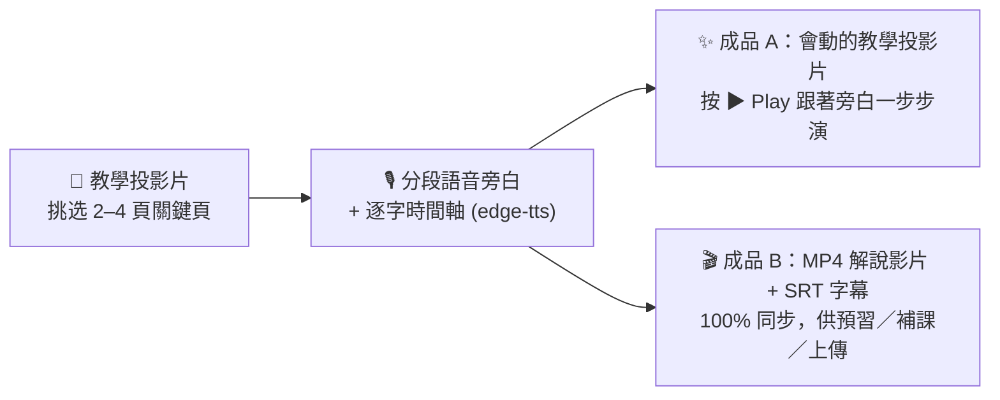
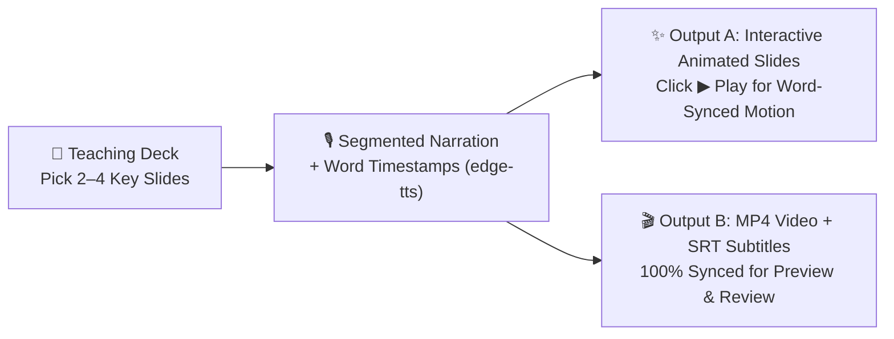

# 🎬 SOIL 動畫教學簡報與解說影片技能（`soil-motion-html`）— AI & Language Learning 課堂中英雙語指南
# 🎬 SOIL Animated Teaching Slides & Explainer Video Skill (`soil-motion-html`) — Bilingual Student Guide

> 🌐 **[🇹🇼 中文版說明與安裝指南（請往下捲動）](#-第一部分中文版使用說明與安裝指南-traditional-chinese)** ｜ **[🇺🇸 Click Here for English Usage & Installation Guide](#-part-2-english-usage--installation-guide)**
>
> 📄 **進階完整教學講義 / Standalone Complete Tutorials**:
> - 📘 [中文完整教學講義 (`docs/TUTORIAL_ZH.md`)](./docs/TUTORIAL_ZH.md)
> - 📗 [English Complete Tutorial (`docs/TUTORIAL_EN.md`)](./docs/TUTORIAL_EN.md)

---

## 🇹🇼 第一部分：中文版使用說明與安裝指南 (Traditional Chinese)

### 一、 這套 Skill 是什麼？解決什麼問題？

在製作投影片時，有些概念光靠「靜態投影片」很難讓學習者一眼看懂（例如：**前後對照改錯、迷思翻轉 ❌➔✅、對話回合推演、網站或 AI 操作流程**）。但如果做完投影片又要另外重頭剪一支教學影片，不但費時，還常發生「影片跟投影片內容不同步」的問題。

本技能（改編並擴充自 [`mathruffian-dot/soil-motion-deck`](https://github.com/mathruffian-dot/soil-motion-deck)）的核心理念是 **「一次製作，兩份成品（Build Once, Two Outputs）」**：



| 成品 | 產出內容 | 適用情境 |
| :--- | :--- | :--- |
| **成品 A：動畫教學投影片** | 將簡報中 2～4 個關鍵頁升級為**可按 `▶ Play` 播放的步驟動畫頁**：<br>• 畫面上的重點高亮、展開卡片、對話泡泡、打字動作、❌/✅ 印章，精準對齊旁白的**每一個字（Word-Boundary Timestamps）**<br>• 內建 `🔊 Voice on / 🔇 Voice off`、`⟲ Replay` 與分段跳轉按鈕（Chips） | 課堂投影教學、學生課後自學（瀏覽器直接開啟 HTML、Teaching Cockpit） |
| **成品 B：獨立解說影片**<br>（`.mp4` ＋ `.srt` 字幕） | 直接從同一份動畫與同一條旁白音軌自動錄製合成 **1280×720 高畫質 `.mp4` 影片與 `.srt` 字幕檔**（支援軟字幕或 `--burn` 燒錄字幕、以及 `--join` 多頁合併成一支完整影片） | 課前預習、缺課補課、上傳至 YouTube / 教學平台 |

---

### 二、 這個技能需要什麼？

安裝本儲存庫後，你的 AI Agent 會獲得 **`soil-motion-html`** 技能：

| 搭配的簡報格式 | 核心特色 | 環境需求 |
| :--- | :--- | :--- |
| **HTML 互動網頁簡報**（`soil-html-deck` 產出的 `.html`） | • 成品 A 直接在 `.html` 投影片內建 **CEFR B1 英文語音旁白＋逐字同步動畫播放器**，學習者自己點開網頁就能邊聽邊看<br>• 成品 B 直接呼叫電腦內建的 Edge / Chrome 自動錄出 `.mp4` 影片＋`.srt` 字幕 | Python 3 與三個 Python 套件（`edge-tts`、`playwright`、`imageio-ffmpeg`），安裝指令會一起裝好。支援 **Antigravity** 與 **OpenCode** |

---

### 三、 Step 0：先準備一個專案資料夾

安裝技能只要做一次，在哪裡裝都一樣；但**製作動畫時，AI 只讀得到你目前打開的資料夾**，做出來的試做檔、旁白與影片也會存在這個資料夾裡。所以開始之前，請先：

1. 在桌面建立一個**英文名稱、沒有空格**的資料夾，例如 `Week13_Motion`（整個路徑最好也不要有中文）。
2. 把要做動畫的 `.html` 投影片**複製**一份放進去（用複製的，原檔就不會被改到）。
3. 用 AI Agent 打開這個資料夾：**Antigravity** 用 New Project 選這個資料夾；**OpenCode** 在這個資料夾裡啟動。
4. 開一個**新對話**，再進行下面的安裝與製作。

完成後，`_motion_trial.html` 試做檔、`slides/motion/` 旁白資料與 `videos/` 影片都會在這個資料夾裡，交作業時直接從這裡拿。

---

### 四、 Step 1：如何安裝？（只需做一次，支援 Antigravity / OpenCode / Claude Code / Codex）

你**完全不需要自己開終端機找資料夾路徑**！只要打開你正在使用的 AI Agent（**Google Antigravity** 或 **OpenCode**），複製下方對應的一段話貼進對話框，AI 就會自動幫你把技能與必備的 Python 語音／錄影套件全部安裝好。

#### 💬 複製貼給 AI Agent 自動安裝

##### 選項 1：通用一鍵安裝指令（同時安裝技能到 Antigravity / OpenCode / Claude Code / Codex ＋ 安裝必備 Python 套件）
直接複製以下**整段話**貼給你的 **Antigravity** 或 **OpenCode**：
```text
請幫我完成以下兩件事：
1. 把 https://github.com/MeiChen-ai/soil-motion-deck.git 完整 clone 到暫存資料夾，並執行裡面的安裝腳本（或將 skills/ 底下的 soil-motion-html 完整資料夾複製到 ~/.gemini/config/skills/、~/.config/opencode/skills/、~/.agents/skills/ 與 ~/.claude/skills/，若資料夾不存在請自動建立），確認 SKILL.md、scripts/、templates/、references/ 與 docs/ 都完整包含。
2. 幫我執行 pip install edge-tts playwright imageio-ffmpeg 安裝好語音旁白與 MP4 影片匯出套件。
```

##### 選項 2：如果你只用 Google Antigravity
```text
請幫我把 https://github.com/MeiChen-ai/soil-motion-deck.git 完整 clone 下來，將 skills/ 底下的 soil-motion-html 完整資料夾複製到我的 ~/.gemini/config/skills/ 目錄下（若資料夾不存在請自動建立），並幫我執行 pip install edge-tts playwright imageio-ffmpeg 安裝必備套件。
```

##### 選項 3：如果你只用 OpenCode
```text
請幫我把 https://github.com/MeiChen-ai/soil-motion-deck.git 完整 clone 下來，將 skills/ 底下的 soil-motion-html 完整資料夾同時複製到我的 ~/.config/opencode/skills/ 與 ~/.agents/skills/ 目錄下（若資料夾不存在請自動建立），並幫我執行 pip install edge-tts playwright imageio-ffmpeg 安裝必備套件。
```

*(💡 註：`render_video.py` 直接呼叫你電腦原本就有的 Microsoft Edge 或 Google Chrome 瀏覽器錄製影片，**不需要**另外下載龐大的 Chromium 瀏覽器檔案！)*

---

### 五、 Step 2：哪些投影片適合做成動畫頁？（選頁黃金原則）

一份 10～15 頁的教學簡報，**不需要每一頁都做動畫**（通常挑 **2～4 頁關鍵頁** 效果最好）：

* ✅ **非常適合做動畫的頁面（「隨時間改變」本身就是教學重點）**：
  1. **迷思翻轉／病句改錯（Myth-Busting & Error Correction）**：先出現學習者常犯的錯誤句 ➔ 蓋上 ❌ 印章並標出問題字 ➔ 展開 ✅ 正確改寫與語用提示。
  2. **前後對照與因果變化（Before vs. After / Cause & Effect）**：例如「直白無禮的請求（Too Blunt）」如何一步步加上 Hedging 變成「得體禮貌的請求（Appropriate）」。
  3. **多步驟推演或對話回合（Step-by-Step Process / Dialogue Turns）**：例如三回合跨文化溝通情境、或是網站／AI 工具的操作步驟示範（打字 ➔ 送出 ➔ 顯示回饋）。
* ⏸️ **建議維持靜態的頁面**：
  * 封面頁、總覽比較大表、單字清單、Your Turn 學生實作練習頁（這些頁面讓學習者自己照步調慢慢讀或動手做更好）。

---

### 六、 Step 3：貼一段話開始，之後回答 AI 的問題

在 Step 0 的資料夾、新對話裡，**只要貼這一段**（把 `[...]` 換成你的檔名）：

#### 📋 開始範本：請 AI 分析投影片，推薦哪幾頁適合做動畫
```text
請使用 soil-motion-html 技能，幫我讀取資料夾裡的 `[你的投影片檔名.html]`，逐頁分析哪些頁面適合改成「英文旁白動畫頁」。請用表格列出每頁是「很適合／可以做／不需要」以及預計「動畫怎麼演」，先讓我確認要挑哪幾頁！
```

接下來 AI 會一步一步問你，照下表回答即可：

| AI 會問 | 你可以這樣回 |
| :--- | :--- |
| 要把哪幾頁做成動畫？ | 「第 3 頁和第 6 頁。」 |
| （做好 `_motion_trial.html` 試做檔後）要不要轉成 MP4 影片？ | **先別急著答應！** 先用 Chrome 或 Edge 打開試做檔、按 ▶ Play 試聽，有問題就請它修，例如：「第 6 頁的 ✅ 出現太早，請在念到 could 時才出現。」確認沒問題後再回：「好，請轉成 MP4，並把英文字幕燒進影片。」 |

> ⚠️ 影片是從試做檔錄出來的，試做檔有錯，影片也會跟著錯，所以**一定要先試聽、修好，再轉影片**。

> 💡 如果 AI 列完表就停住、沒有繼續問：直接說「請把第 3、6 頁做成動畫」；做完動畫沒問影片：直接說「請轉成 MP4，並把英文字幕燒進影片」。

---
---

## 🇺🇸 Part 2: English Usage & Installation Guide

### 1. What Is `soil-motion-html` & What Problem Does It Solve?

When making slides, static slides often struggle to show **processes that unfold over time**—such as **step-by-step sentence revision, myth-busting flips (❌ Misconception ➔ ✅ Target Form), multi-turn dialogue pragmatics, or UI walkthroughs**. Yet building a slide deck and then separately editing a video takes double the effort and quickly leads to version drift.

This skill (adapted and expanded from [`mathruffian-dot/soil-motion-deck`](https://github.com/mathruffian-dot/soil-motion-deck)) follows a strict **"Build Once, Two Outputs"** workflow:



| Output | Format & Features | Target Use Case |
| :--- | :--- | :--- |
| **Output A: Animated Teaching Slides** | Upgrades 2–4 key slides into interactive **`▶ Play` step-by-step animated slides**:<br>• Visual actions (callouts, folding cards, chat bubbles, typing effects, ❌/✅ stamps) are anchored to **exact word-level timestamps (`WordBoundary`)** from `edge-tts`<br>• Includes `🔊 Voice on / 🔇 Voice off`, `⟲ Replay`, clickable chapter chips, and a live progress bar | Live classroom projection & self-paced student review (standalone HTML deck or Teaching Cockpit) |
| **Output B: Standalone Explainer Video**<br>(`.mp4` + `.srt` subtitles) | Automatically records Output A and muxes the exact same voiceover track and auto-chunked `.srt` subtitles into a **1280×720 H.264 `.mp4` video** (supports soft subtitle tracks, `--burn` for burned-in captions, and `--join` to combine clips) | Pre-class preview, make-up lessons, YouTube / LMS upload |

---

### 2. What Does the Skill Need?

Installing this repository gives your AI Agent the **`soil-motion-html`** skill:

| Target Slide Format | Key Features | Requirements |
| :--- | :--- | :--- |
| **Interactive HTML Decks** (`.html` built with `soil-html-deck`) | • **Output A** embeds spoken **CEFR B1 English voiceover + word-synced animations** directly inside your `.html` slide deck so learners can press `▶ Play` anytime in their browser<br>• **Output B** uses your local Edge/Chrome browser (`render_video.py`) to export `.mp4` + `.srt` videos | Python 3 plus three Python packages (`edge-tts`, `playwright`, `imageio-ffmpeg`), installed by the prompt below. Works in **Google Antigravity** and **OpenCode** |

---

### 3. Step 0: Make a Project Folder First

You install the skill only once, and it does not matter which folder you are in. But **when you make animations, the AI can only read the folder you have open**, and it saves the trial file, narration and video in that folder. So before you start:

1. On your desktop, create a folder with an **English name and no spaces**, e.g. `Week13_Motion` (avoid Chinese characters anywhere in the path).
2. **Copy** the `.html` deck you want to animate into it (a copy keeps your original safe).
3. Open this folder in your AI agent: in **Antigravity**, use New Project and choose this folder; in **OpenCode**, start it inside this folder.
4. Start a **new chat**, then install and build as described below.

When you finish, the `_motion_trial.html` trial file, the `slides/motion/` narration files and the `videos/` folder will all be in this folder, ready to submit.

---

### 4. Step 1: One-Time Installation (Supports Antigravity, OpenCode, Claude Code & Codex)

You do **not** need to manually hunt for hidden skill folders! Simply open your AI Agent (**Google Antigravity** or **OpenCode**), copy one of the blocks below, and paste it directly into the chat box.

#### 💬 Copy & Paste One Prompt to Your AI Agent

##### Option 1: Universal Install Prompt (Installs the Skill to Antigravity, OpenCode, Claude Code & Codex + Required Python Packages)
Copy and paste this entire block into **Antigravity** or **OpenCode**:
```text
Please help me complete these two setup steps:
1. Clone https://github.com/MeiChen-ai/soil-motion-deck.git into a temporary folder and run its installer script (or copy `soil-motion-html` from `skills/` into `~/.gemini/config/skills/`, `~/.config/opencode/skills/`, `~/.agents/skills/`, and `~/.claude/skills/`, creating the directories if they do not exist). Make sure `SKILL.md`, `scripts/`, `templates/`, `references/`, and `docs/` are all preserved.
2. Run `pip install edge-tts playwright imageio-ffmpeg` so neural voiceover generation and MP4 video rendering are ready to use.
```

##### Option 2: Google Antigravity Only
```text
Please clone https://github.com/MeiChen-ai/soil-motion-deck.git, copy `soil-motion-html` from `skills/` into my global Antigravity skills folder at `~/.gemini/config/skills/` (create the folder if needed), and run `pip install edge-tts playwright imageio-ffmpeg`.
```

##### Option 3: OpenCode Only
```text
Please clone https://github.com/MeiChen-ai/soil-motion-deck.git, copy `soil-motion-html` from `skills/` into `~/.config/opencode/skills/` and `~/.agents/skills/` (create the folders if needed), and run `pip install edge-tts playwright imageio-ffmpeg`.
```

*(💡 Note: `render_video.py` uses your computer's pre-installed Microsoft Edge or Google Chrome browser via `channel="msedge"`, so you do **not** need to run `playwright install` to download extra browsers!)*

---

### 5. Step 2: Which Slides Should You Animate? (Golden Rules)

In a 10–15 slide teaching deck, **do not animate every slide**—animating **2 to 4 key slides** creates the strongest learning impact:

* ✅ **Great Candidates for Animation (where *change over time* is the teaching point)**:
  1. **Myth-Busting & Error Correction Flips**: Show a common learner error ➔ stamp ❌ and highlight the problem word ➔ unfold ✅ the target revision and explanation.
  2. **Before-and-After / Cause-and-Effect Comparisons**: E.g., watching a blunt request step-by-step gain hedging words to become pragmatically appropriate.
  3. **Multi-Step Processes & UI Walkthroughs**: E.g., a 3-turn dialogue sequence, or typing a prompt ➔ clicking send ➔ receiving two-step hint feedback.
* ⏸️ **Keep Static**:
  * Cover slides, reference tables, vocabulary lists, and "Your Turn" practice tasks (where learners need to read and work at their own pace).

---

### 6. Step 3: Paste One Prompt, Then Answer the AI's Questions

In your Step 0 folder, in a new chat, **paste only this prompt** (replace `[...]` with your file name):

#### 📋 Starter Prompt: Inspect Your Deck & Recommend Slides to Animate
```text
Please use the `soil-motion-html` skill to inspect `[your-deck.html]` and evaluate each slide for animation. Give me a table categorizing slides into "Great Fit / Possible / Keep Static" with a one-sentence description of how each candidate animation would play out, so I can choose which 2–4 slides to animate!
```

The AI will then ask you questions one at a time. Here is how to answer:

| The AI asks | You can reply |
| :--- | :--- |
| Which slides should I animate? | "Slides 3 and 6, please." |
| (After making the `_motion_trial.html` trial file) Shall I turn it into an MP4 video? | **Not yet!** First open the trial file in Chrome or Edge, press ▶ Play and listen. Ask for fixes, e.g. "On slide 6 the ✅ appears too early: show it when the voice says 'could'." When it is right, reply: "Yes, please make the MP4 and burn the English subtitles into the video." |

> ⚠️ The video is recorded from the trial file, so any mistake in the trial file ends up in the video too. **Always listen and fix first, then make the video.**

> 💡 If the AI stops after the table, just say "Please animate slides 3 and 6." If it does not ask about a video after the animations are done, say "Please make the MP4 and burn the English subtitles into the video."

---

### 7. Repository Structure & Credits

```text
soil-motion-deck/
├── README.md                                 # Bilingual Student & Classroom Guide (this file)
├── LICENSE                                   # MIT License
├── NOTICE.md                                 # Upstream & third-party attribution notices
├── docs/
│   ├── TUTORIAL_ZH.md                        # Complete Traditional Chinese Tutorial
│   └── TUTORIAL_EN.md                        # Complete English Tutorial & Technical Reference
├── install/
│   ├── install.ps1                           # Windows PowerShell installer (Antigravity/OpenCode/Claude/Codex)
│   └── install.sh                            # macOS / Linux Bash installer
└── skills/
    └── soil-motion-html/                     # 🌟 HTML Narrated Motion Slides + MP4
        ├── SKILL.md
        ├── scripts/ (make_narration.py, build_motion.py, render_video.py, check_motion.js)
        ├── templates/ (motion_engine.js, motion.css)
        └── references/lessons.md
```

* **Upstream Author & Core Concept**: Adapted from [`mathruffian-dot/soil-motion-deck`](https://github.com/mathruffian-dot/soil-motion-deck) (based on Prof. Chun-Yi Lee's **SOIL Teaching Deck Workflow**).
* **`soil-motion-html` Adaptation & Bilingual Classroom Packaging**: Packaged by **MeiChen-ai (Ya-mei Chen)** for the *AI and Language Learning* course.
* **License**: [MIT License](LICENSE) (see [NOTICE.md](NOTICE.md) for third-party notices).
