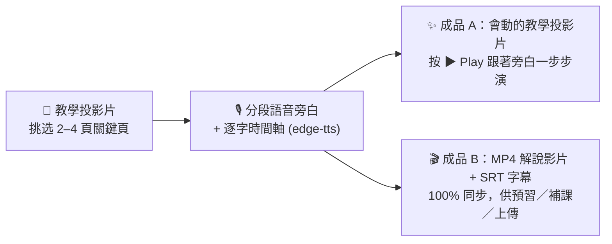
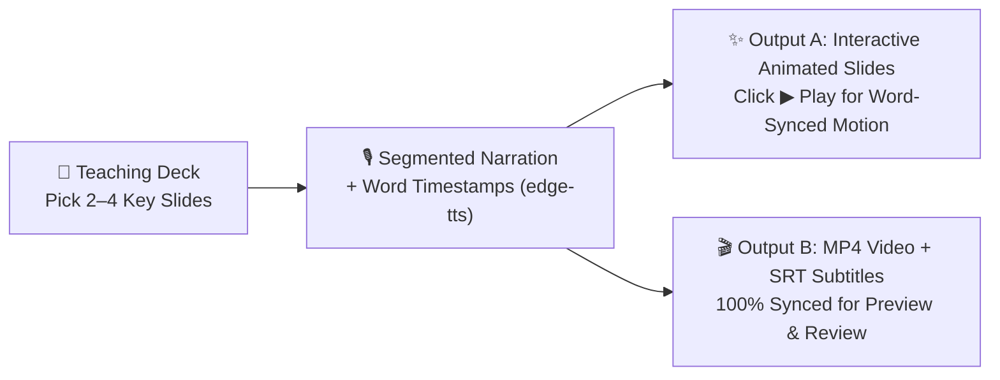

# 🎬 SOIL 動畫教學簡報與解說影片技能集（`soil-motion-deck`）— AI & Language Learning 課堂中英雙語指南
# 🎬 SOIL Animated Teaching Slides & Explainer Video Skills (`soil-motion-deck`) — Bilingual Student Guide

> 🌐 **[🇹🇼 中文版說明與安裝指南（請往下捲動）](#-第一部分中文版使用說明與安裝指南-traditional-chinese)** ｜ **[🇺🇸 Click Here for English Usage & Installation Guide](#-part-2-english-usage--installation-guide)**
>
> 📄 **進階完整教學講義 / Standalone Complete Tutorials**:
> - 📘 [中文完整教學講義 (`docs/TUTORIAL_ZH.md`)](./docs/TUTORIAL_ZH.md)
> - 📗 [English Complete Tutorial (`docs/TUTORIAL_EN.md`)](./docs/TUTORIAL_EN.md)

---

## 🇹🇼 第一部分：中文版使用說明與安裝指南 (Traditional Chinese)

### 一、 這套 Skill 是什麼？解決什麼問題？

在製作語言學習與微學習（Microlearning）投影片時，有些概念光靠「靜態投影片」很難讓學習者一眼看懂（例如：**前後對照改錯、迷思翻轉 ❌➔✅、對話回合推演、網站或 AI 操作流程**）。但如果做完投影片又要另外重頭剪一支教學影片，不但費時，還常發生「影片跟投影片內容不同步」的問題。

本技能集（改編並擴充自 [`mathruffian-dot/soil-motion-deck`](https://github.com/mathruffian-dot/soil-motion-deck)）的核心理念是 **「一次製作，兩份成品（Build Once, Two Outputs）」**：



| 成品 | 產出內容 | 適用情境 |
| :--- | :--- | :--- |
| **成品 A：動畫教學投影片** | 將簡報中 2～4 個關鍵頁升級為**可按 `▶ Play` 播放的步驟動畫頁**：<br>• 畫面上的重點高亮、展開卡片、對話泡泡、打字動作、❌/✅ 印章，精準對齊旁白的**每一個字（Word-Boundary Timestamps）**<br>• 內建 `🔊 Voice on / 🔇 Voice off`、`⟲ Replay` 與分段跳轉按鈕（Chips） | 課堂投影教學、學生課後自學（瀏覽器直接開啟 HTML、Teaching Cockpit） |
| **成品 B：獨立解說影片**<br>（`.mp4` ＋ `.srt` 字幕） | 直接從同一份動畫與同一條旁白音軌自動錄製合成 **1280×720 高畫質 `.mp4` 影片與 `.srt` 字幕檔**（支援軟字幕或 `--burn` 燒錄字幕、以及 `--join` 多頁合併成一支完整影片） | 課前預習、缺課補課、上傳至 YouTube / 教學平台 |

---

### 二、 內含 2 個技能差在哪裡？課堂上該選哪一個？

安裝本儲存庫後，你的 AI Agent 會同時獲得 **2 個動畫簡報技能**。**在「AI & Language Learning」課堂上，強烈推薦優先使用第 1 個（`soil-motion-html`）**：

| 技能名稱 | 搭配的簡報格式 | 核心特色與環境需求 | 課堂選用建議 |
| :--- | :--- | :--- | :--- |
| **`soil-motion-html`**<br>🌟 **課堂學生首選**<br>*(HTML 英文旁白動畫版)* | **HTML 互動網頁簡報**<br>（搭配 `soil-html-deck` 產出的 `.html`） | • **完全免裝 HyperFrames！**<br>• 成品 A 直接在 `.html` 投影片內建 **CEFR B1 英文語音旁白＋逐字同步動畫播放器**，不靠老師現場講解，學習者自己點開網頁就能邊聽邊看<br>• 成品 B 直接呼叫電腦內建的 Edge / Chrome 自動錄出 `.mp4` 影片＋`.srt` 字幕 | ✅ **最適合所有同學使用！**<br>只要先用 `soil-html-deck` 做好網頁投影片，就能用這個技能挑 2～4 頁做成有聲英文動畫頁與 MP4 影片（支援 **Antigravity** 與 **OpenCode**） |
| **`soil-motion-deck`**<br>🎬 *進階 PPTX 原版*<br>*(PowerPoint + HyperFrames 版)* | **PowerPoint 簡報**<br>（搭配 `soil-teaching-deck` 的 `.pptx`） | • 先用 `HyperFrames` 做出完整配音字幕解說片（成品 B），再從「靜音孿生版」剪出無聲 MP4 片段嵌進 `.pptx` 投影片（成品 A）供講者現場邊播邊講<br>• *需額外安裝 `claude-motion-explainer`、`HyperFrames` 與 `ffmpeg`* | 適合進階需要產出 **內嵌影片之 `.pptx` 檔**、且電腦已安裝好 HyperFrames 環境的使用者 |

---

### 三、 Step 1：如何安裝？（只需做一次，支援 Antigravity / OpenCode / Claude Code / Codex）

你**完全不需要自己開終端機找資料夾路徑**！只要打開你正在使用的 AI Agent（**Google Antigravity** 或 **OpenCode**），複製下方對應的一段話貼進對話框，AI 就會自動幫你把技能與必備的 Python 語音／錄影套件全部安裝好。

#### 💬 複製貼給 AI Agent 自動安裝

##### 選項 1：通用一鍵安裝指令（同時安裝技能到 Antigravity / OpenCode / Claude Code / Codex ＋ 安裝必備 Python 套件）
直接複製以下**整段話**貼給你的 **Antigravity** 或 **OpenCode**：
```text
請幫我完成以下兩件事：
1. 把 https://github.com/MeiChen-ai/soil-motion-deck.git 完整 clone 到暫存資料夾，並執行裡面的安裝腳本（或將 skills/ 底下的 soil-motion-html 與 soil-motion-deck 兩個完整資料夾複製到 ~/.gemini/config/skills/、~/.config/opencode/skills/、~/.agents/skills/ 與 ~/.claude/skills/，若資料夾不存在請自動建立），確認 SKILL.md、scripts/、templates/、references/ 與 docs/ 都完整包含。
2. 幫我執行 pip install edge-tts playwright imageio-ffmpeg 安裝好語音旁白與 MP4 影片匯出套件。
```

##### 選項 2：如果你只用 Google Antigravity
```text
請幫我把 https://github.com/MeiChen-ai/soil-motion-deck.git 完整 clone 下來，將 skills/ 底下的 soil-motion-html 與 soil-motion-deck 兩個完整資料夾複製到我的 ~/.gemini/config/skills/ 目錄下（若資料夾不存在請自動建立），並幫我執行 pip install edge-tts playwright imageio-ffmpeg 安裝必備套件。
```

##### 選項 3：如果你只用 OpenCode
```text
請幫我把 https://github.com/MeiChen-ai/soil-motion-deck.git 完整 clone 下來，將 skills/ 底下的 soil-motion-html 與 soil-motion-deck 兩個完整資料夾同時複製到我的 ~/.config/opencode/skills/ 與 ~/.agents/skills/ 目錄下（若資料夾不存在請自動建立），並幫我執行 pip install edge-tts playwright imageio-ffmpeg 安裝必備套件。
```

*(💡 註：`render_video.py` 直接呼叫你電腦原本就有的 Microsoft Edge 或 Google Chrome 瀏覽器錄製影片，**不需要**另外下載龐大的 Chromium 瀏覽器檔案！)*

---

### 四、 Step 2：哪些投影片適合做成動畫頁？（選頁黃金原則）

一份 10～15 頁的教學簡報，**不需要每一頁都做動畫**（通常挑 **2～4 頁關鍵頁** 效果最好）：

* ✅ **非常適合做動畫的頁面（「隨時間改變」本身就是教學重點）**：
  1. **迷思翻轉／病句改錯（Myth-Busting & Error Correction）**：先出現學習者常犯的錯誤句 ➔ 蓋上 ❌ 印章並標出問題字 ➔ 展開 ✅ 正確改寫與語用提示。
  2. **前後對照與因果變化（Before vs. After / Cause & Effect）**：例如「直白無禮的請求（Too Blunt）」如何一步步加上 Hedging 變成「得體禮貌的請求（Appropriate）」。
  3. **多步驟推演或對話回合（Step-by-Step Process / Dialogue Turns）**：例如三回合跨文化溝通情境、或是網站／AI 工具的操作步驟示範（打字 ➔ 送出 ➔ 顯示回饋）。
* ⏸️ **建議維持靜態的頁面**：
  * 封面頁、總覽比較大表、單字清單、Your Turn 學生實作練習頁（這些頁面讓學習者自己照步調慢慢讀或動手做更好）。

---

### 五、 Step 3：課堂實戰 Prompt 範本（直接複製修改 `【...】` 即可使用）

#### 📋 範本 1：請 AI 分析你的 HTML 投影片，推薦哪幾頁適合做動畫（Step 1 挑頁）
```text
請使用 soil-motion-html 技能，幫我讀取資料夾裡的 `[你的投影片檔名.html]`，逐頁分析哪些頁面適合改成「英文旁白動畫頁」。請用表格列出每頁是「很適合／可以做／不需要」以及預計「動畫怎麼演」，先讓我確認要挑哪幾頁！
```

#### 📋 範本 2：把選定的頁面做成「英文旁白動畫頁」（產出成品 A）
```text
請使用 soil-motion-html 技能，把 `[你的投影片檔名.html]` 的第 【例如：3, 6, 8】 頁做成英文旁白動畫頁：
1. 在 `slides/motion/[簡報名稱]/` 建立 spec 資料夾並備份 `original.html`。
2. 為這幾頁撰寫清楚易懂的 CEFR B1 英文分段旁白（每頁約 30–50 秒），用 `make_narration.py` 產生 MP3 語音與逐字時間軸。
3. 設計左欄步驟重點＋右欄固定高度動畫視窗版面，對齊逐字秒數寫好 `configs.js`（讓念到關鍵字的瞬間觸發高亮、展開或 ❌/✅ 標記）。
4. 用 `build_motion.py` 組出 `_motion_trial.html` 試做檔並檢查版面無溢出，把試做檔路徑與每頁旁白全文表格交給我試聽！
```

#### 📋 範本 3：把做好的動畫頁匯出成「MP4 解說影片＋SRT 字幕」（產出成品 B）
```text
我已經試聽確認動畫頁沒問題了！請使用 soil-motion-html 的 `render_video.py`，把 `[組好的投影片檔名.html]` 裡的動畫頁錄製成 1280x720 的 MP4 解說影片與 SRT 字幕，存到 `videos/` 資料夾，並用 `--burn` 把英文字幕燒錄進畫面（同時用 `--join` 合併成一支完整影片）。
```

#### 📋 範本 4：使用原版 `soil-motion-deck` 製作 `.pptx` 內嵌動畫簡報＋HyperFrames 影片（進階選用）
```text
請使用 soil-motion-deck 技能，幫我為【教學主題】設計一份可編輯的 .pptx 教學簡報與 MP4 解說影片（對象：【教學對象】，時間：【上課時間】）。請先依 SOIL 引擎一～三規劃每頁角色並標出 2–3 頁 🎬 動畫頁讓我確認！
```

---
---

## 🇺🇸 Part 2: English Usage & Installation Guide

### 1. What Is `soil-motion-deck` & What Problem Does It Solve?

In language teaching and microlearning design, static slides often struggle to show **processes that unfold over time**—such as **step-by-step sentence revision, myth-busting flips (❌ Misconception ➔ ✅ Target Form), multi-turn dialogue pragmatics, or UI walkthroughs**. Yet building a slide deck and then separately editing a video takes double the effort and quickly leads to version drift.

This skill package (adapted and expanded from [`mathruffian-dot/soil-motion-deck`](https://github.com/mathruffian-dot/soil-motion-deck)) follows a strict **"Build Once, Two Outputs"** workflow:



| Output | Format & Features | Target Use Case |
| :--- | :--- | :--- |
| **Output A: Animated Teaching Slides** | Upgrades 2–4 key slides into interactive **`▶ Play` step-by-step animated slides**:<br>• Visual actions (callouts, folding cards, chat bubbles, typing effects, ❌/✅ stamps) are anchored to **exact word-level timestamps (`WordBoundary`)** from `edge-tts`<br>• Includes `🔊 Voice on / 🔇 Voice off`, `⟲ Replay`, clickable chapter chips, and a live progress bar | Live classroom projection & self-paced student review (standalone HTML deck or Teaching Cockpit) |
| **Output B: Standalone Explainer Video**<br>(`.mp4` + `.srt` subtitles) | Automatically records Output A and muxes the exact same voiceover track and auto-chunked `.srt` subtitles into a **1280×720 H.264 `.mp4` video** (supports soft subtitle tracks, `--burn` for burned-in captions, and `--join` to combine clips) | Pre-class preview, make-up lessons, YouTube / LMS upload |

---

### 2. Which of the 2 Included Skills Should I Choose?

Installing this repository gives your AI Agent **2 motion skills**. **For the "AI & Language Learning" course, we strongly recommend Skill 1 (`soil-motion-html`)**:

| Skill Name | Target Slide Format | Key Features & Requirements | Classroom Recommendation |
| :--- | :--- | :--- | :--- |
| **`soil-motion-html`**<br>🌟 **Recommended for Class**<br>*(HTML Narrated Motion Edition)* | **Interactive HTML Decks**<br>(built with `soil-html-deck`) | • **Zero HyperFrames setup required!**<br>• **Output A** embeds spoken **CEFR B1 English voiceover + word-synced animations** directly inside your `.html` slide deck so learners can press `▶ Play` anytime in their browser<br>• **Output B** uses your local Edge/Chrome browser (`render_video.py`) to export `.mp4` + `.srt` videos | ✅ **Best choice for all students!**<br>Works seamlessly in both **Google Antigravity** and **OpenCode** with only lightweight Python packages (`edge-tts`, `playwright`, `imageio-ffmpeg`) |
| **`soil-motion-deck`**<br>🎬 *Advanced PPTX Edition*<br>*(PowerPoint + HyperFrames)* | **PowerPoint Decks**<br>(`.pptx` built with `soil-teaching-deck`) | • Renders a full explainer video in `HyperFrames` (Output B), then cuts silent, caption-free MP4 clips from a "silent twin" render and embeds them into `.pptx` slides (Output A) for live teacher narration<br>• *Requires installing `claude-motion-explainer`, `HyperFrames`, and `ffmpeg`* | For advanced users who specifically need `.pptx` files with embedded silent video clips and have `HyperFrames` installed |

---

### 3. Step 1: One-Time Installation (Supports Antigravity, OpenCode, Claude Code & Codex)

You do **not** need to manually hunt for hidden skill folders! Simply open your AI Agent (**Google Antigravity** or **OpenCode**), copy one of the blocks below, and paste it directly into the chat box.

#### 💬 Copy & Paste One Prompt to Your AI Agent

##### Option 1: Universal Install Prompt (Installs Both Skills to Antigravity, OpenCode, Claude Code & Codex + Required Python Packages)
Copy and paste this entire block into **Antigravity** or **OpenCode**:
```text
Please help me complete these two setup steps:
1. Clone https://github.com/MeiChen-ai/soil-motion-deck.git into a temporary folder and run its installer script (or copy both `soil-motion-html` and `soil-motion-deck` from `skills/` into `~/.gemini/config/skills/`, `~/.config/opencode/skills/`, `~/.agents/skills/`, and `~/.claude/skills/`, creating the directories if they do not exist). Make sure `SKILL.md`, `scripts/`, `templates/`, `references/`, and `docs/` are all preserved.
2. Run `pip install edge-tts playwright imageio-ffmpeg` so neural voiceover generation and MP4 video rendering are ready to use.
```

##### Option 2: Google Antigravity Only
```text
Please clone https://github.com/MeiChen-ai/soil-motion-deck.git, copy both `soil-motion-html` and `soil-motion-deck` from `skills/` into my global Antigravity skills folder at `~/.gemini/config/skills/` (create the folder if needed), and run `pip install edge-tts playwright imageio-ffmpeg`.
```

##### Option 3: OpenCode Only
```text
Please clone https://github.com/MeiChen-ai/soil-motion-deck.git, copy both `soil-motion-html` and `soil-motion-deck` from `skills/` into `~/.config/opencode/skills/` and `~/.agents/skills/` (create the folders if needed), and run `pip install edge-tts playwright imageio-ffmpeg`.
```

*(💡 Note: `render_video.py` uses your computer's pre-installed Microsoft Edge or Google Chrome browser via `channel="msedge"`, so you do **not** need to run `playwright install` to download extra browsers!)*

---

### 4. Step 2: Which Slides Should You Animate? (Golden Rules)

In a 10–15 slide teaching deck, **do not animate every slide**—animating **2 to 4 key slides** creates the strongest learning impact:

* ✅ **Great Candidates for Animation (where *change over time* is the teaching point)**:
  1. **Myth-Busting & Error Correction Flips**: Show a common learner error ➔ stamp ❌ and highlight the problem word ➔ unfold ✅ the target revision and explanation.
  2. **Before-and-After / Cause-and-Effect Comparisons**: E.g., watching a blunt request step-by-step gain hedging words to become pragmatically appropriate.
  3. **Multi-Step Processes & UI Walkthroughs**: E.g., a 3-turn dialogue sequence, or typing a prompt ➔ clicking send ➔ receiving two-step hint feedback.
* ⏸️ **Keep Static**:
  * Cover slides, reference tables, vocabulary lists, and "Your Turn" practice tasks (where learners need to read and work at their own pace).

---

### 5. Step 3: Ready-to-Use Classroom Prompt Templates

#### 📋 Template 1: Inspect an HTML Deck & Recommend Slides to Animate (`soil-motion-html`)
```text
Please use the `soil-motion-html` skill to inspect `[your-deck.html]` and evaluate each slide for animation. Give me a table categorizing slides into "Great Fit / Possible / Keep Static" with a one-sentence description of how each candidate animation would play out, so I can choose which 2–4 slides to animate!
```

#### 📋 Template 2: Turn Selected HTML Slides into English-Narrated Motion Slides (Output A)
```text
Please use the `soil-motion-html` skill to turn slides [e.g., 3, 6, 8] of `[your-deck.html]` into English-narrated animated slides:
1. Create the spec folder at `slides/motion/[deck-name]/` and back up `original.html`.
2. Write clear CEFR B1-level segmented English narration (30–50 seconds per slide) and run `make_narration.py` to generate MP3 audio and exact word timings.
3. Build the two-column motion layouts (`slides.html` + `slides.css`) and word-synced timeline (`configs.js`) so visual highlights, folding cards, and ❌/✅ stamps trigger right as each keyword is spoken.
4. Compile `<deck>_motion_trial.html` with `build_motion.py`, verify zero layout overflow, and share the trial file path and full narration table for my review!
```

#### 📋 Template 3: Export Animated HTML Slides to MP4 Explainer Videos + SRT Subtitles (Output B)
```text
I have reviewed the trial motion slides and they look great! Please use `render_video.py` from `soil-motion-html` to record all animated slides in `[your-motion-deck.html]` into 1280x720 MP4 videos + SRT subtitles inside the `videos/` folder, burn the English subtitles into the video (`--burn`), and also combine them into a single `full_explainer.mp4` video (`--join`).
```

#### 📋 Template 4: Build an Animated `.pptx` Deck + HyperFrames MP4 Film (`soil-motion-deck` — Advanced)
```text
Please use the `soil-motion-deck` skill to plan an editable `.pptx` teaching deck and an MP4 explainer video on [Topic] for [Target Learners & Duration]. Please run SOIL Engines 1–3 first and mark 2–3 candidate 🎬 animated slides for my confirmation!
```

---

### 6. Repository Structure & Credits

```text
soil-motion-deck/
├── README.md                                 # Bilingual Student & Classroom Guide (this file)
├── LICENSE                                   # MIT License
├── NOTICE.md                                 # Upstream & third-party attribution notices
├── docs/
│   ├── TUTORIAL_ZH.md                        # Complete Traditional Chinese Tutorial
│   ├── TUTORIAL_EN.md                        # Complete English Tutorial & Technical Reference
│   └── (deck-overview-1.png, deck-overview-2.png, film-sheet.png)
├── install/
│   ├── install.ps1                           # Windows PowerShell installer (Antigravity/OpenCode/Claude/Codex)
│   └── install.sh                            # macOS / Linux Bash installer
└── skills/
    ├── soil-motion-html/                     # 🌟 Skill 1 (Classroom Recommended): HTML Narrated Motion Slides + MP4
    │   ├── SKILL.md
    │   ├── scripts/ (make_narration.py, build_motion.py, render_video.py, check_motion.js)
    │   ├── templates/ (motion_engine.js, motion.css)
    │   └── references/lessons.md
    └── soil-motion-deck/                     # 🎬 Skill 2 (Original PPTX + HyperFrames Edition)
        ├── SKILL.md
        ├── scripts/ (make_silent.py, cut_clips.py, thumbs.py, export_thumbs.ps1)
        ├── templates/ (deck_helpers.js, example_pythagoras.js, package.json)
        └── references/lessons.md
```

* **Upstream Author & Core Concept**: Adapted from [`mathruffian-dot/soil-motion-deck`](https://github.com/mathruffian-dot/soil-motion-deck) (based on Prof. Chun-Yi Lee's **SOIL Teaching Deck Workflow**).
* **`soil-motion-html` Adaptation & Bilingual Classroom Packaging**: Packaged by **MeiChen-ai (Ya-mei Chen)** for the *AI and Language Learning* course.
* **License**: [MIT License](LICENSE) (see [NOTICE.md](NOTICE.md) for third-party notices).
